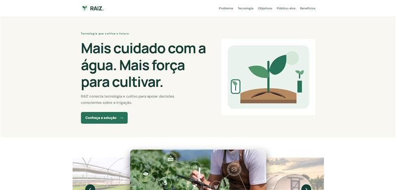

<p align="center">
  
</p>

<h1 align="center">RAIZ</h1>

<p align="center"><em>Mais cuidado com a água. Mais força para cultivar.</em></p>

Landing page do **Projeto RAIZ**, desenvolvida pelo grupo **SONDER** para a Global Solution 2026.2 da FIAP (tema CitizenTech).



## Sobre o projeto

O RAIZ é um sensor de umidade do solo para pequenos produtores de hortaliça folhosa do cinturão verde da Região Metropolitana de São Paulo. Um app projeta em quantas horas será preciso irrigar, o que ajuda a economizar água e a proteger a colheita.

O projeto se conecta às ODS **2** (Fome zero), **9** (Indústria, inovação e infraestrutura), **10** (Redução das desigualdades) e **13** (Ação contra a mudança do clima).

## Seções da página

- **Problema**: o desafio de irrigar sem desperdício
- **Tecnologia**: como o sensor e o app funcionam
- **Objetivos**: o que o RAIZ quer alcançar
- **Público-alvo**: quem o projeto atende
- **Benefícios**: o ganho para o produtor
- **Feedback**: formulário para o visitante deixar sua opinião

## Tecnologias

- **HTML5**: estrutura semântica (`header`, `main`, `section`, `footer`)
- **CSS3**: variáveis, Flexbox, `clamp()`, `position: sticky` e layout responsivo com `@media`
- **JavaScript**: validação e envio do formulário de feedback

## Estrutura

```
GS_FRONT_END/
├── index.html       # página principal
├── css/styles.css   # estilos
├── js/script.js     # função enviarFeedback()
├── img/             # imagens das seções
├── docs/            # logo e print usados no README
├── ia.md            # declaração de uso de IA
└── INTEGRANTES.md
```

## Como executar

1. Clone o repositório:
   ```bash
   git clone https://github.com/L1nguin3/GS_FRONT_END.git
   ```
2. Abra o arquivo `index.html` no navegador.

Não é preciso instalar nada.

## Integrantes

| Nome | RM |
| --- | --- |
| Guilherme Andrade Dos Santos Trevisan | 576676 |
| João Victor Matos de Almeida | 574928 |
| David Manoel Barros Pereira | 576915 |
| Lucas dos Santos Gomes | 576912 |
| Thales Bernardino Seixas | 574617 |

## Uso de IA

Veja como o grupo usou IA como ferramenta de estudo em [ia.md](ia.md).

---

**Grupo SONDER** · Global Solution 2026.2 · FIAP
